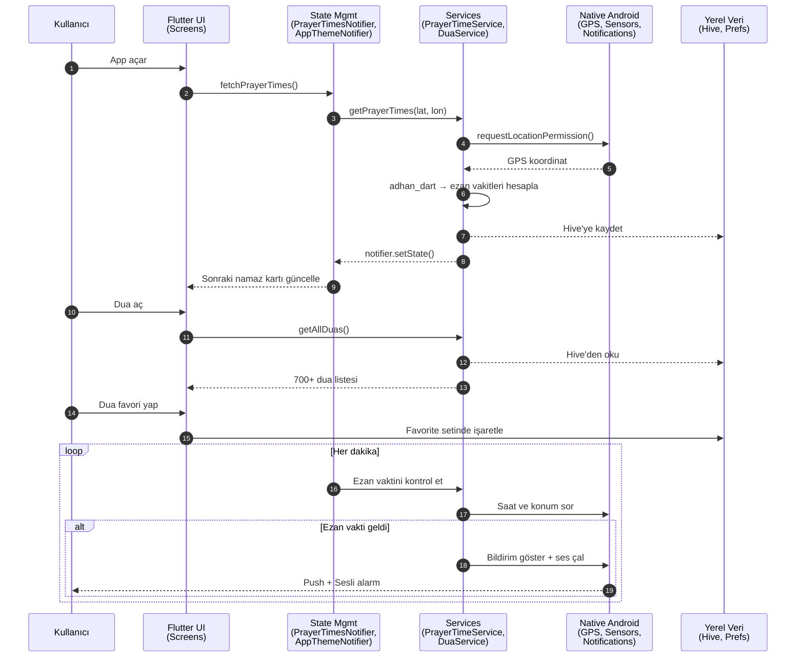

# İman Uygulaması

<p align="center">
  
</p>

<p align="center">
  <a href="https://pub.dev/packages/flutter">=3.0.0" src="https://img.shields.io/static/v1?label=Flutter&message=%3E%3D3.0.0&color=02569B&style=flat-square&logo=flutter"></a>
  <a href="#">=3.0.0" src="https://img.shields.io/static/v1?label=Dart&message=%3E%3D3.0.0&color=0175C2&style=flat-square&logo=dart"></a>
  <a href="#"></a>
  <a href="#"></a>
  <a href="#"></a>
</p>

**İman Uygulaması**, cihaz içi (offline) çalışan, **hicri takvime bağlı ezan vakitleri**, Kur'an duaları, zikir sayacı ve namaz rehberleriyle **şahsi ibadet yardımcısıdır**. WiFi olmadan, GPS olmadan, veri tabanı üstü kayıt edilerek çalışır.

---

## ✨ Öne Çıkan Özellikler

- 📍 **Konuma Dayalı Ezan Vakitleri** (`adhan_dart` + `geolocator`): Gerçek zamanlı Hicri takvim, Kıble yönü (manyetik pusula sensörü), 5 vakit ve ihtiyat vakitleri.
- 🤲 **700+ Dua Kütüphanesi** (kategorize): Huzur, Şifa, Rızık, Korunma, Peygamber duaları; sesli tilavet (`flutter_tts`); favori işaretleme; okundu takibi.
- 📿 **Zikir Sayacı** (custom hedef): Varsayılan zikirlere ek olarak kişisel zikir ekle; tur sayacı; günlük/haftalık istatistikler; çalkalama haptic feedback.
- 🕌 **Namaz ve Abdest Rehberi** (adım-adım): `rive` animasyonlarıyla görsel rehber; namaz duaları entegre.
- 🔔 **Akıllı Bildirimler** (`flutter_local_notifications` + `timezone`): Ezan bildirim zamanla; bildirim öncesi sesli uyarı; sessiz saat ayarı.
- 🌙 **Hicri Takvim ve İslami Günler** (`hijri`): Ramazan, Kurban Bayramı, Aşure günü otomatik işareti; Kandil saatleri.
- 💾 **Çevrimdışı Senkronizasyon** (`hive` + `shared_preferences`): İnternet olmadan yerel veri kaydetme; çevrimiçi olunca bulut sync (hazır).
- 🌗 **Koyu/Açık Tema** (`provider`): Material 3 dinamik renkler; font boyutu ayarı (erişilebilirlik).
- 📊 **İbadet İstatistikleri**: Haftalık zikir grafiği; okunmuş dua sayısı; en çok okunan dualar.
- 🎵 **Sesli Rehber ve TTS** (`flutter_tts`): Dua tilaveti, namaz adımlarının Türkçe sesli anlatımı, kıraat seçenekleri.

---

## 📱 Ekran Görünümleri

Uygulamadaki ana akış — ezan zamanından duaya, zikre ve istatistiklere:


| Ekran | Öne Çıkan Özellikler |
|---|---|
| **HomeScreen** | Sonraki namaz sayaç (countdown), Hicri tarihi, ezan bildirimi durumu, İslami takvim widget |
| **DuaScreen** | Kategoriye göre dua filtresi, arama, ses tilaveti, favori ekle/çıkar, okundu işareti |
| **ZikirScreen** | Sayaç ✋ buton, hedef ve tur, haftalık grafik, kişisel zikir ekleme |
| **PrayerGuideScreen** | Abdest ve 5 vakit namaz rehberi, `rive` animasyonlu adım-adım |
| **PrayerTimesScreen** | Günün 5 ezan vakti, kıble yönü (pusula), şehir değiştir |
| **StatisticsScreen** | Haftalık zikir, en çok okunan dualar, ibadet serisi (gün sayısı) |
| **SettingsScreen** | Tema seç, font boyutu, bildirim zamanları, izinler, dil |

---

## 🛠️ Nasıl Çalışır?

<p align="center">
  
</p>

**Adım 1: Başlangıç ve Lokasyon** — Uygulama açılınca `PrayerTimeService.init()` GPS koordinatını alır ve `adhan_dart` kütüphanesiyle Hicri takvim oluşturur.

**Adım 2: Ezan Vaktini Hesapla** — Her dakika `PrayerTimesNotifier` Fajr, Dhuhr, Asr, Maghrib, Isha vakitlerini yeniden kontrol eder; yaklaştığında `NotificationService` tetikler.

**Adım 3: Dua ve Zikir Yönetimi** — `DuaService` JSON verilerinden 700+ duayı yükler, `ZikirStorageService` kişiye ait sayaç ve istatistikleri Hive'de tutar.

**Adım 4: Bildir ve Persiste Et** — Ezan saati gelince push bildirim gönderilir; tüm veriler yerel Hive veri tabanında kalıcı hale getirilir.

---

## 🏛️ Teknik Mimari

<p align="center">
  
</p>



### Katman ve Sorumluluk Tablosu

| Katman | Dosya / Sınıf | Sorumluluk |
|---|---|---|
| **UI Layer** | `HomeScreen`, `DuaScreen`, `ZikirScreen`, `PrayerGuideScreen`, `SettingsScreen` | Kullanıcı arayüzü, tab navigasyon, form input |
| **State Mgmt** | `PrayerTimesNotifier`, `AppThemeNotifier` (Provider) | Ezan vakitleri, tema (koyu/açık) durumu | 
| **Services** | `PrayerTimeService`, `DuaService`, `ZikirStorageService`, `NotificationService` | İş mantığı: ezan hesapla, bildirim gönder, veri fetch |
| **Storage** | `HiveStorageService`, `OfflineSyncService` (Hive + SharedPreferences) | Kalıcı veri: dualar, zikir sayacı, ayarlar, çevrimdışı cache |
| **Native** | `MainActivity`, Android Permission Handler, Sensors | GPS, pusula, bildirim, sistem izinleri |

---

## 📂 Proje Dizin Yapısı

```
iman_uygulamasi/
├── lib/
│   ├── main.dart                           # App entry point, Provider setup
│   ├── screens/                            # 11 ekran (home, dua, zikir, namaz rehberi vb.)
│   │   ├── home_screen.dart                # Ana sayfa: sonraki namaz, hicri takvim
│   │   ├── dua_screen.dart                 # 700+ dua, kategorize, sesli tilavet
│   │   ├── zikir_screen.dart               # Sayaç, hedef, tur, istatistik
│   │   ├── prayer_guide_screen.dart        # Abdest + 5 vakit namaz rehberi
│   │   ├── prayer_times_screen.dart        # Gün detayları, Kıble, şehir seç
│   │   ├── statistics_screen.dart          # Haftalık grafik, en çok okunmuş dualar
│   │   ├── settings_screen.dart            # Tema, font, bildirim ayarları
│   │   ├── wudu_guide_screen.dart          # Abdest adımları animasyonlu
│   │   ├── notification_scheduler_screen.dart # Bildirim saati ayarla
│   │   └── (diğer 2 ekran)
│   ├── services/                           # Business logic
│   │   ├── prayer_time_service.dart        # Ezan vakti hesaplama (adhan_dart)
│   │   ├── dua_service.dart                # Dua yönetimi
│   │   ├── zikir_storage_service.dart      # Zikir sayaç persiste
│   │   ├── notification_service.dart       # Push ve sesli bildirim
│   │   ├── hive_storage_service.dart       # Hive veri tabanı wrapper
│   │   ├── offline_sync_service.dart       # Çevrimdışı senkronizasyon
│   │   └── (diğer 3 service)
│   ├── providers/                          # State management (Provider)
│   │   ├── prayer_times_notifier.dart      # Ezan vakitleri state
│   │   └── app_theme_notifier.dart         # Tema state
│   ├── models/                             # Data models
│   │   ├── dua_model.dart                  # Dua veri yapısı
│   │   ├── zikir_model.dart                # Zikir veri yapısı
│   │   ├── prayer_guide_model.dart         # Namaz rehberi adımları
│   │   ├── city_model.dart                 # Şehir (koordinat)
│   │   └── (diğer 2 model)
│   ├── widgets/                            # Reusable widgets
│   │   ├── islamic_calendar_widget.dart    # Hicri takvim 30 güne göster
│   │   ├── status_bar_widget.dart          # Bağlantı durumu, izin uyarıları
│   │   └── (custom widgets)
│   ├── utils/                              # Utility
│   │   ├── app_colors.dart                 # Tema renkleri (Material 3)
│   │   ├── app_exceptions.dart             # Custom exceptions
│   │   └── error_handler.dart              # Hata yönetimi
│   └── assets/                             # Kaynaklar
│       ├── data/
│       │   ├── islamic_calendar.json       # Hicri takvim
│       │   └── quran_prayers.json          # Kur'an duaları
│       ├── sounds/                         # Ezan sesi, dua Türkçe TTS
│       └── images/, animations/, fonts/    # Görseller, Rive animasyonları, özel fontlar
├── android/
│   ├── app/build.gradle.kts                # Compile SDK 34, Min 21, Java 17
│   └── app/src/main/AndroidManifest.xml    # GPS, bildirim, sensör izinleri
├── pubspec.yaml                            # Proje metadata, paket bağımlılıkları
├── README.md                               # Bu dosya
└── docs/
    └── images/
        ├── hero.svg                        # Hero banner
        ├── how-it-works.svg                # 4 adım
        └── architecture.svg                # Teknik mimari
```

---

## 🚀 Kurulum ve Derleme

### Gereksinimler
- **Flutter SDK:** >=3.0.0 (https://flutter.dev/docs/get-started/install)
- **Dart SDK:** >=3.0.0 (Flutter ile birlikte gelir)
- **Android Studio** veya **VS Code** + Flutter extension
- **Android:** minSdk 21, targetSdk 34 (Android 14)
- **Disk:** ~500MB (build artifacts dahil)

### Adımlar

1. **Kodu klonla:**
   ```powershell
   git clone https://github.com/ismailsoylemez-dev/iman-app.git
   cd iman-app
   ```

2. **Paketleri yükle:**
   ```powershell
   flutter pub get
   ```

3. **Kodu analiz et:**
   ```powershell
   flutter analyze
   ```

4. **Testleri çalıştır:**
   ```powershell
   flutter test
   ```

5. **Cihazda çalıştır (debug):**
   ```powershell
   flutter run
   ```

6. **APK oluştur (release):**
   ```powershell
   flutter build apk --release
   ```
   APK dosyası `build/app/outputs/flutter-apk/app-release.apk` konumunda.

---

## 🔐 İzinler ve Gizlilik

### Android İzinleri

| İzin | Amaç | Kullanıcı Etkisi |
|---|---|---|
| `ACCESS_FINE_LOCATION` | GPS → Ezan vakitleri hisab | Konum paylaşılmazsa varsayılan il kullanılır (sıkıntılı) |
| `ACCESS_COARSE_LOCATION` | Kaba konum (hücre tabanlı) | Fine location kapalıysa fallback |
| `POST_NOTIFICATIONS` | Ezan alarm, duya bildirimleri | Kapatılırsa bildirimler görünmez |
| `SENSOR` | Manyetik pusula (Kıble yönü) | Sensör yoksa Kıble sabit gösterilir |

### Gizlilik

- **Veri Nerede:** Tüm veriler cihazin Hive veri tabanında (Wexler, Flutter paketinin yerel NoSQL'i) kalır; hiçbir sunucuya gönderilmez.
- **Dış Servisler:** 
  - `adhan_dart` — Ezan vakti hesaplanırken Fajr açısı vb. tamamen cihazda yapılır; API yok.
  - `geolocator` — GPS doğrudan Android Location Services'ten alınır; üçüncü tarafa gönderilmez.
  - `flutter_local_notifications` — Bildirimler sistem seviyesinde; veri gönderilmez.
  - **İnternet:** Opsiyonel; offline 100% çalışır, internet varsa sonraki gün ezan vakitleri prefetch edilir.
- **Reklam:** Yok.
- **Analitik:** Yok. İbadet takibi tamamen gizlidir.
- **Şifreleme:** Hive cihazde şifrelenmiş değil (yerel depo güvenli ortam varsayar); hassas veri yok.

---

## 📜 Lisans

MIT License — Özgür kullanım, değiştirme ve dağıtım (kredi alınarak).

---

## 👤 Geliştirici

**İsmail Söylemez**  
GitHub: [@ismailsoylemez-dev](https://github.com/ismailsoylemez-dev)  
İstanbul, Türkiye

---

## 🤝 Katkı

Hata raporları ve geliştirme önerileri için [GitHub Issues](https://github.com/ismailsoylemez-dev/iman-app/issues) aç.

---

**Son güncelleme:** Eylül 2026 — Ezan vakti, dua kütüphanesi, zikir istatistikleri, offline senkronizasyon
